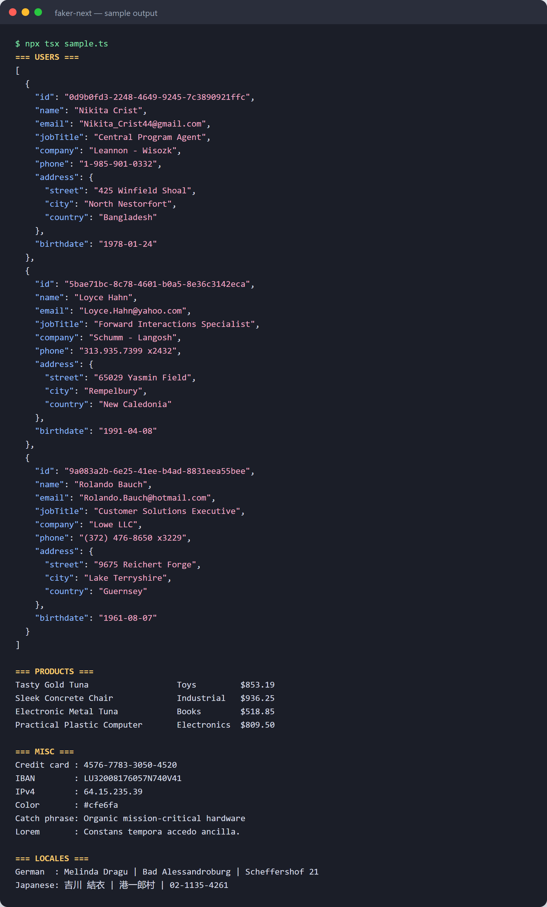

# About this copy of Faker

This folder is an unmodified copy of **[Faker](https://github.com/faker-js/faker)** (`@faker-js/faker` v10.6.0, from its `next` branch), an open-source library for generating realistic fake data for testing and development.

> **Not written by Claude Code.** Faker was written by the Faker team and its contributors, and is distributed under the [MIT License](LICENSE). Its full history is at https://github.com/faker-js/faker. The only files added here are this one and a short note at the top of `README.md`.

## How Claude Code was used

Unlike the other projects in this repo, this one wasn't generated. It was downloaded and then **explored with Claude Code**, which read the codebase and explained how it works. The prompts were:

> explain this code

> explain me about this project

## What the library does

Faker generates fake but realistic data, such as names, emails, addresses, phone numbers, companies, products, prices, dates, finance data and more, in over 70 locales. Developers use it to fill test databases, build UI mock-ups and write tests without real personal data.

Its source is organized like this:

| Path | What's in it |
| --- | --- |
| `src/modules/` | One module per data area (`person`, `location`, `internet`, `commerce`, `finance`, `date`, `lorem`, ...). Each exposes the methods you call, like `faker.person.firstName()`. |
| `src/locales/` | Locale data: the word lists and formats for each language and region. |
| `src/faker.ts`, `src/simple-faker.ts` | The `Faker` class, which combines modules with locale data, and `SimpleFaker`, the subset that doesn't need locale data. |
| `src/randomizer.ts`, `src/internal/` | The seedable random number generator that makes output reproducible. |
| `test/` | Vitest unit tests, including snapshot tests of seeded output. |
| `docs/` | The VitePress documentation site at [fakerjs.dev](https://fakerjs.dev). |

## Running it

The project uses [pnpm](https://pnpm.io/) and Node.js (see `.nvmrc` for the version).

```bash
cd faker-next
pnpm install
pnpm run build   # build the library into dist/
pnpm run test    # run the unit tests
```

## Sample output



The same output as text, with the script that produced it:

This script was run against the source in this folder with `npx tsx`, using a fixed seed so the results are reproducible:

```ts
import { faker, fakerDE, fakerJA } from './src';

faker.seed(42);

const firstName = faker.person.firstName();
const lastName = faker.person.lastName();
const user = {
  id: faker.string.uuid(),
  name: `${firstName} ${lastName}`,
  email: faker.internet.email({ firstName, lastName }),
  jobTitle: faker.person.jobTitle(),
  company: faker.company.name(),
  phone: faker.phone.number(),
  address: {
    street: faker.location.streetAddress(),
    city: faker.location.city(),
    country: faker.location.country(),
  },
  birthdate: faker.date.birthdate({ min: 18, max: 65, mode: 'age' }),
};
// ...repeated for 3 users, then products, misc values and other locales
```

**Users**

```json
[
  {
    "id": "0d9b0fd3-2248-4649-9245-7c3890921ffc",
    "name": "Nikita Crist",
    "email": "Nikita_Crist44@gmail.com",
    "jobTitle": "Central Program Agent",
    "company": "Leannon - Wisozk",
    "phone": "1-985-901-0332",
    "address": {
      "street": "425 Winfield Shoal",
      "city": "North Nestorfort",
      "country": "Bangladesh"
    },
    "birthdate": "1978-01-24"
  },
  {
    "id": "5bae71bc-8c78-4601-b0a5-8e36c3142eca",
    "name": "Loyce Hahn",
    "email": "Loyce.Hahn@yahoo.com",
    "jobTitle": "Forward Interactions Specialist",
    "company": "Schumm - Langosh",
    "phone": "313.935.7399 x2432",
    "address": {
      "street": "65029 Yasmin Field",
      "city": "Rempelbury",
      "country": "New Caledonia"
    },
    "birthdate": "1991-04-08"
  },
  {
    "id": "9a083a2b-6e25-41ee-b4ad-8831eea55bee",
    "name": "Rolando Bauch",
    "email": "Rolando.Bauch@hotmail.com",
    "jobTitle": "Customer Solutions Executive",
    "company": "Lowe LLC",
    "phone": "(372) 476-8650 x3229",
    "address": {
      "street": "9675 Reichert Forge",
      "city": "Lake Terryshire",
      "country": "Guernsey"
    },
    "birthdate": "1961-08-07"
  }
]
```

**Products** (`commerce.productName()`, `commerce.department()`, `commerce.price()`)

```
Tasty Gold Tuna                  Toys         $853.19
Sleek Concrete Chair             Industrial   $936.25
Electronic Metal Tuna            Books        $518.85
Practical Plastic Computer       Electronics  $809.50
```

**Other modules**

```
Credit card : 4576-7783-3050-4520
IBAN        : LU32008176057N740V41
IPv4        : 64.15.235.39
Color       : #cfe6fa
Catch phrase: Organic mission-critical hardware
Lorem       : Constans tempora accedo ancilla.
```

**Other locales** (`fakerDE` for German, `fakerJA` for Japanese)

```
German  : Melinda Dragu | Bad Alessandroburg | Scheffershof 21
Japanese: 吉川 結衣 | 港一郎村 | 02-1135-4261
```

With the same seed, Faker returns the same values every time. Birthdates are the exception: they're calculated relative to today's date, so they shift slightly over time. This sample was generated on November 8, 2026.

Every value above is fake. Any resemblance to real people, companies or card numbers is coincidental.
