# Job Portal UI 💼

A job portal single-page app with three roles. Job seekers browse and apply for jobs, employers post listings and review applicants, and admins manage companies, employers and contact messages.

There is no backend. Services in `src/services/` simulate async API calls over mock data (1,000 jobs across 30 companies), and everything you do is saved to your browser's localStorage.

## Screenshots

**Home**: hero with job search by keyword and location

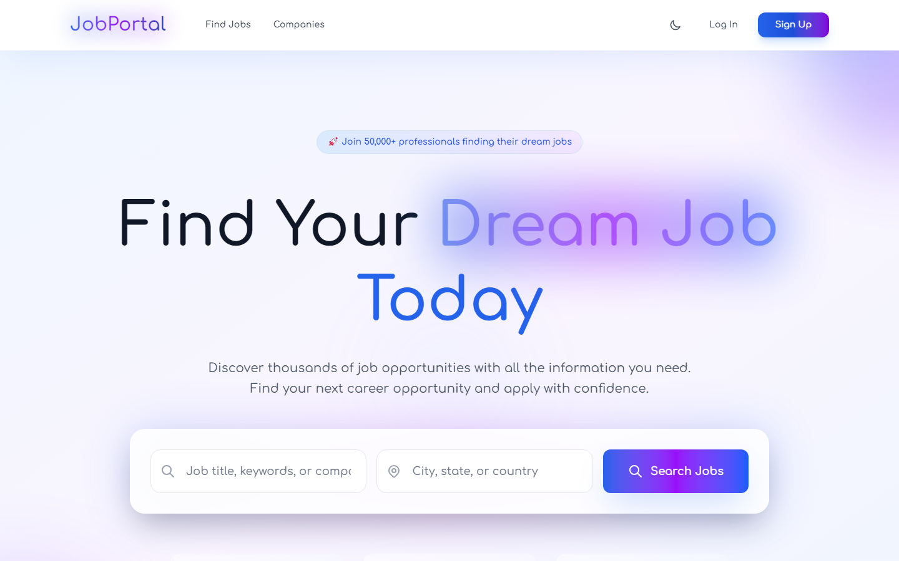

**Find Jobs**: search and filter 1,000 jobs by category, experience, work type, salary and remote

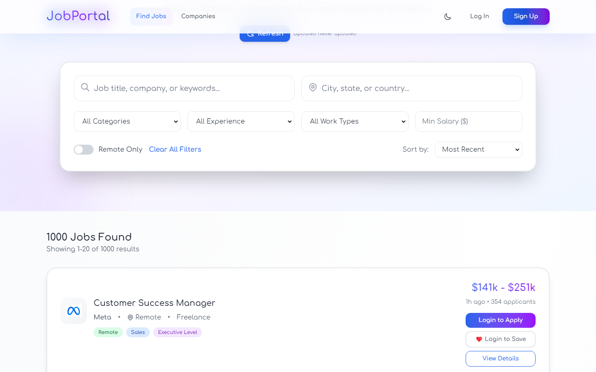

| Job detail | Companies |
| --- | --- |
| 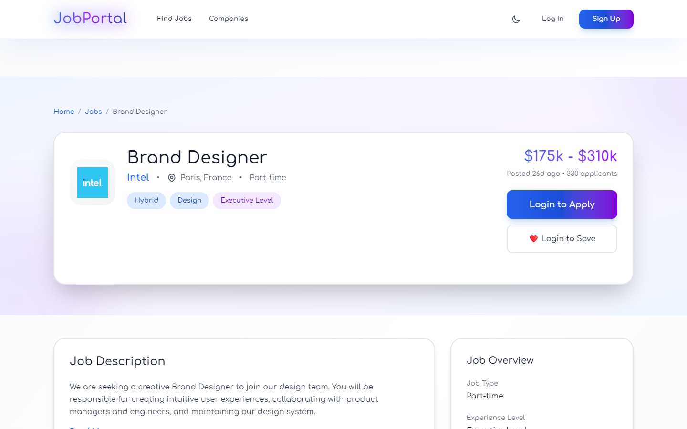 | 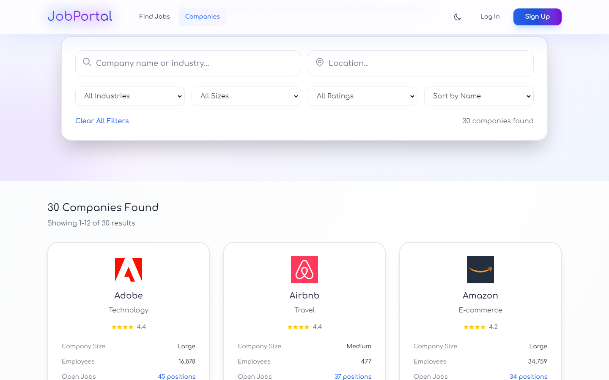 |

| Login with demo accounts | Dark mode |
| --- | --- |
| 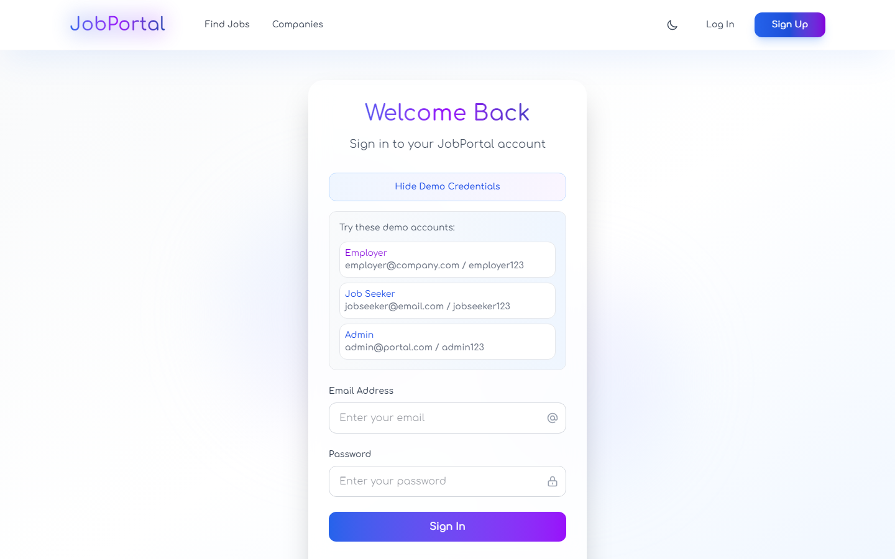 | 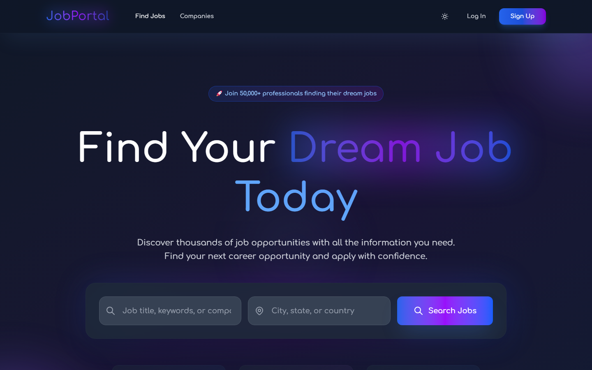 |

**Job seeker**

| Profile | Applied jobs |
| --- | --- |
| 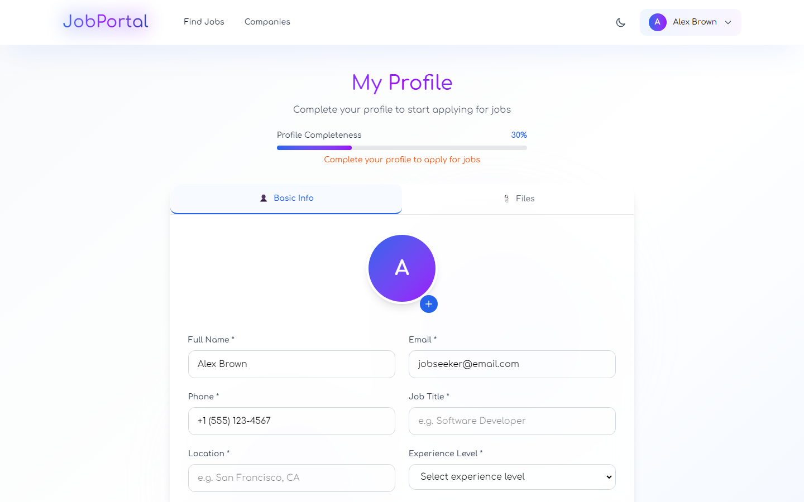 | 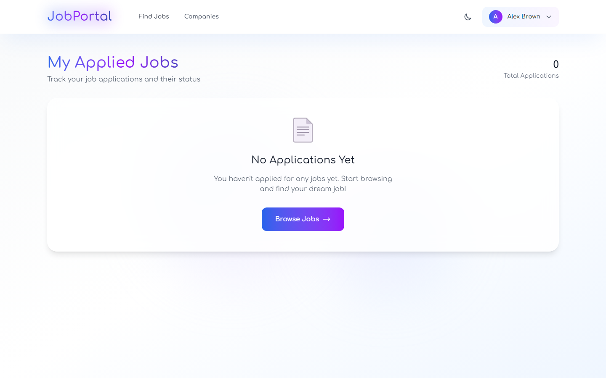 |

**Employer**

| Post a job | My posted jobs |
| --- | --- |
| 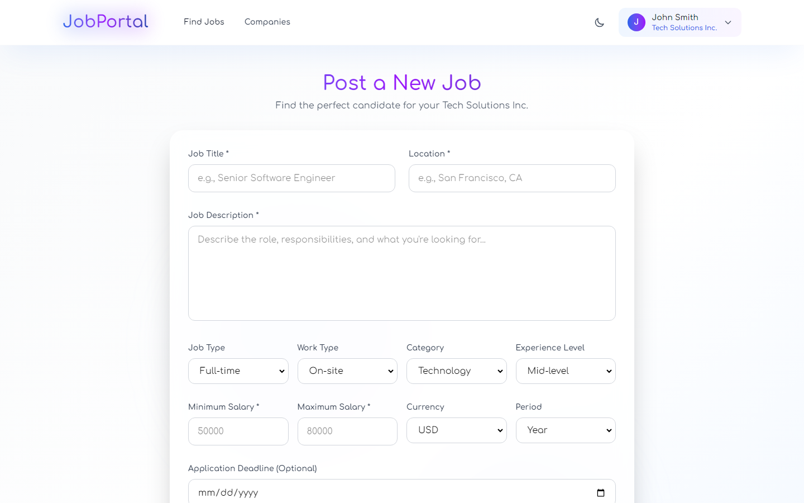 | 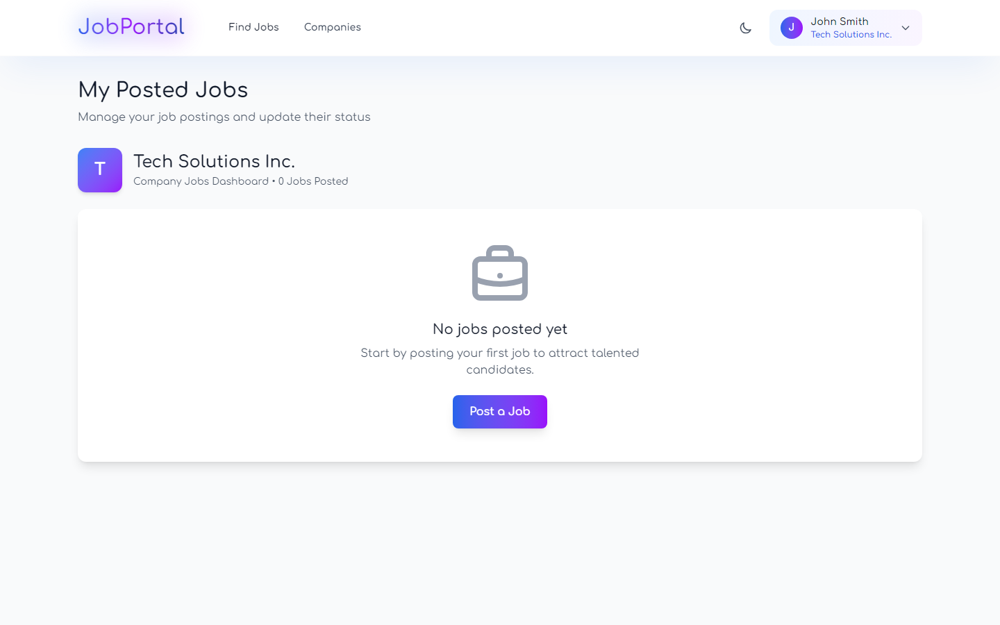 |

**Admin**

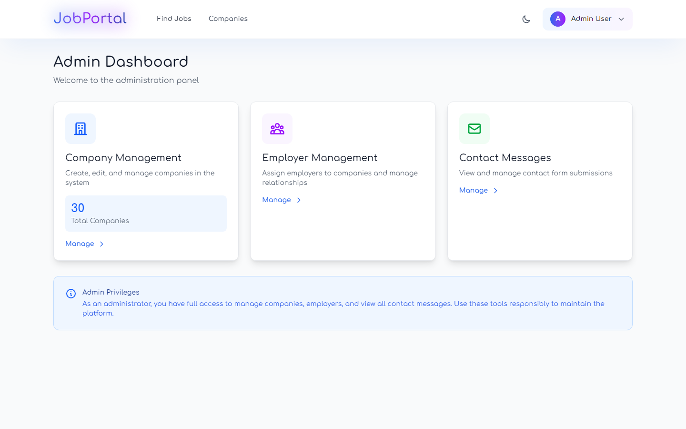

**Mobile**

| Home | Jobs |
| --- | --- |
| 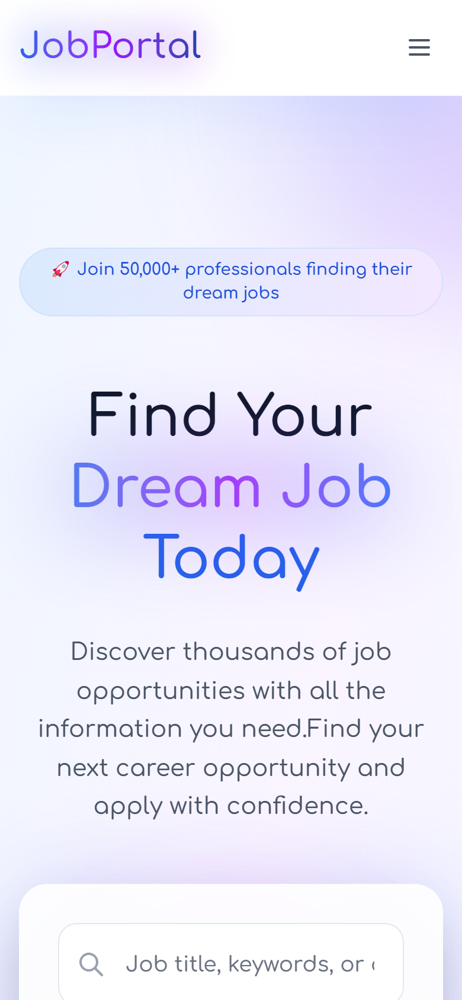 | 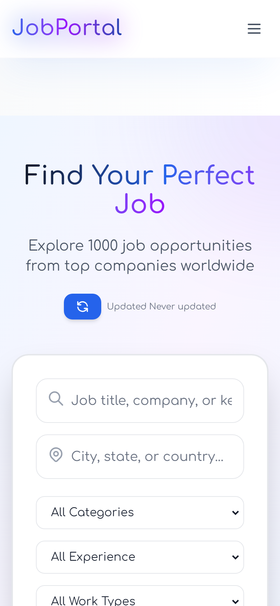 |

## Features

- **Job search** with keyword, location, category, experience level, work type, minimum salary and remote-only filters, plus sorting and pagination.
- **Job and company detail pages** with salary, job overview and open positions.
- **Job seekers** can build a profile, apply for jobs, save jobs and track their applications.
- **Employers** can post, edit and manage jobs and review the applicants for each one.
- **Admins** can manage companies, assign employers to companies and read contact form messages.
- **Role-based routes.** Pages for each role are protected and redirect to login.
- **Dark mode** toggle, remembered between visits.
- **Responsive** layout with a mobile menu.

## Running it

```bash
npm install
npm run dev
```

Then open the URL Vite prints (usually http://localhost:5173).

### Demo accounts

| Role | Email | Password |
| --- | --- | --- |
| Job seeker | jobseeker@email.com | jobseeker123 |
| Employer | employer@company.com | employer123 |
| Admin | admin@portal.com | admin123 |

The login page also has a **Show Demo Credentials** button that fills these in.

## Tech stack

React 19, Vite 7, Tailwind CSS 4, React Router 7, Font Awesome, Lucide React and react-toastify.

## Project structure

```
src/
  components/   Navbar, Footer, Hero, ProtectedRoute and other shared UI
  context/      AuthContext, JobContext, ThemeContext
  contexts/     JobsDataContext (cached job list), CompaniesContext
  data/         mockData.js
  pages/        Home, Jobs, JobDetail, Companies, Profile, PostJob, ...
  pages/admin/  Dashboard, CompanyManagement, EmployerManagement, ContactMessages
  services/     Simulated async API calls
```
